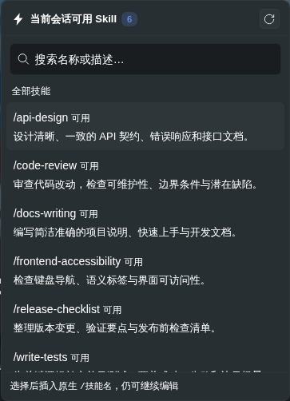

# DSH Skill Collections

[简体中文](<README.md>) | **English**

An isolated Skill library, reusable collections, and **explicit workspace bindings** for DeepSeek Harness (DSH)—with a composer quick picker backed by the **actual native session catalog**.

Keep Skill content in one managed location, group it without duplicating files, and decide which workspaces receive it. The plugin does not infer a project type or enable Skills just because you opened a Unity, Python, or other project.

## How it works

| Layer | Location | Purpose |
| --- | --- | --- |
| Managed library | `$DSH_HOME/skill-collections/library` | Stores imported Skill content outside DSH's default discovery roots. Importing a Skill does not automatically enable it everywhere. |
| Collections | `$DSH_HOME/skill-collections/collections/*.yml` | Groups Skill names; one Skill can belong to several collections without copying its content. |
| Workspace binding | `<workspace>/.dsh/skill-collections.yml` | Records the collections and individual overrides explicitly selected for that workspace. |
| Native mounting | `<workspace>/.dsh/skills` | Uses auditable links so DSH's own Skill discovery and hot loading remain in charge. |

`DSH_HOME` defaults to `~/.dsh` when not configured.

Compatibility: Node.js `^22.19.0 || >=24.0.0`, DSH `>=0.2.1-rc.2 <0.3.0`.
Read the [security and permission boundaries](SECURITY.md) before enabling file
management. [DSH STORE review notes](docs/store-review.md) describe the fixed
dependency locks, complete prebuilt distribution and disposable-Profile checks.
Local verification does not constitute marketplace supply-chain approval.

## Features

- **Skill library, collections, and workspace views** in Settings.
- Import a Skill folder whose root contains `SKILL.md` directly from the interface; uploads go to the managed library, with no destination path to enter.
- Create, edit, and delete collections; enable them only for explicitly selected, registered workspaces.
- Add an individual Skill to a workspace, or disable a member of an enabled collection without editing the collection itself.
- View available Skills for the **selected session**, using the same native `skills/list` catalog as DSH's `/` menu. The catalog follows the session's real working directory and preset scope—not just the managed library.
- Use the **composer quick picker** to insert a Skill invocation into a draft. It does not send the message or run the Skill automatically.
- Keep the native available catalog separate from managed-binding diagnostics, which report link state, missing references, and conflicts.
- Explicitly adopt existing global Skills into the managed library, or make a managed Skill global through a tracked link.
- Access the same management capabilities through the `skill_collection_list` and `skill_collection_manage` Agent tools, including Host-side `import_path` imports.

### Real interface screenshots

The screenshots below show the actual interface with sample Skills and collections. UI labels are in Chinese; the captions describe each view in English.


*Skill library: manage imported content independently of where it is enabled.*


*Collections: group references to Skills, then bind those groups to workspaces explicitly.*



*Composer quick picker: choose from the real session catalog and insert an invocation into the message draft.*

## Install from npm

For a regular installation, no source checkout or local compilation is needed:

```bash
dsh plugin --profile web add dsh-skill-collections
```

Restart DSH after installation or an update. The package includes the Host entry, browser bundle, and loader patch; consumers do not need TypeScript or installation-time build scripts.

The npm package `dsh-skill-collections` and source development package `@dsh-external/dsh-skill-collections` share the same loader entry, routes, and tools. **Do not enable both in the same Profile.** Remove an existing source or injected installation before enabling the npm package, or vice versa.

See the [changelog](<CHANGELOG.md>) for release history.

### Windows

The prebuilt npm package supports Windows without Bash or TypeScript. Import a standard Skill folder containing a root-level `SKILL.md`, then follow the quick start below.

## Quick start

1. **Import.** Open the Skill library in Settings and select a folder with a root-level `SKILL.md`. Importing stores its content; it does not make it available to every project.
2. **Collect.** Create a collection and add the imported Skill names. You can reuse a Skill in multiple collections.
3. **Bind.** Open the workspace view, select a registered workspace, and explicitly enable the collection or individual Skills. Use workspace overrides to exclude a collection member when needed.
4. **Choose.** Return to the desired conversation and open the Skill picker from the composer icon. Its list comes from that session's native catalog, including effective Skills outside the managed library.
5. **Send when ready.** Select a Skill to insert its `/skill-name` invocation into your draft, add your instructions, and send the message yourself. Selection alone does not run the Skill.

When viewing different sessions in the same workspace, their available catalogs can differ because of their working directories or presets. Opening management from the composer prefers the current session; it does not silently switch to a different workspace.

## Native catalog versus managed bindings

These are intentionally different views:

- **Available Skills** come from the native session catalog. They can include unmanaged local Skills, global or shared-user Skills, built-in Skills, preset Skills, and other providers—not only content stored by this plugin.
- **Managed bindings** describe what this plugin has linked for a workspace, with missing references and ownership conflicts shown as diagnostics. They are not presented as the complete native catalog.
- Name precedence, same-name overrides, and user-invocation policies remain native DSH behavior. A model-only Skill is not shown as a user-invocable `/` item. Catalog read failures are reported rather than replaced with an incomplete managed-only list.

Seeing a Skill in the native catalog does not grant this plugin permission to delete, disable, or take ownership of it.

## Global Skills

**Make global** creates a global link to managed content; **cancel global** removes that link while keeping the original in the library. Workspace-level exclusions do not hide global Skills.

Removing a collection or workspace binding does not delete Skill content. The plugin cleans up links it manages and leaves existing same-name user files untouched.

## Configuration examples

A collection definition:

```yaml
version: 1
id: daily-development
name: Daily Development
description: Code review, tests, and documentation
skills:
  - code-review
  - write-tests
  - docs-writing
```

A workspace binding with an individual exclusion:

```yaml
version: 1
collections:
  - daily-development
skills:
  enabled: []
  disabled:
    - docs-writing
```

These examples are explicit workspace selections.

## Development

Repository: [caicongmin/dsh-skill-collections](https://github.com/caicongmin/dsh-skill-collections).

To work on the source, clone the repository:

```bash
git clone https://github.com/caicongmin/dsh-skill-collections.git
cd dsh-skill-collections
```

Run the following commands from the plugin directory, with `DSH_CHECKOUT` pointing to a DSH source checkout that provides the shared SDK and build dependencies:

```bash
DSH_CHECKOUT=/path/to/deepseek-harness npm run build
npm run build:client
npm test
npm run pack:npm
```

- The Host build emits TypeScript declarations and testable modules, then bundles plugin-local Host logic into one ESM entry for generation-consistent hot reloads. Shared runtime dependencies remain external.
- `yaml` is a normal runtime dependency. DSH SDK packages and React remain shared peers; do not install another SDK instance to work around missing Host links.
- `pack:npm` produces and verifies the prebuilt npm package under `release/`. It keeps the package name, loader patch, and browser module ID consistent without replacing the development client bundle.
- Packaging is **not publishing**. See [PUBLISHING.md](<PUBLISHING.md>) for contributor release instructions and [CHANGELOG.md](<CHANGELOG.md>) for version history.

For a local development installation, run this command from the DSH checkout, using the absolute path to this plugin:

```bash
pnpm dsh plugin --profile web add "file:/path/to/dsh-skill-collections"
```

Restart DSH after installing or updating the development package. Do not enable the npm and source packages together.

## License and acknowledgements

Released under the [MIT License](<LICENSE>).

The management interface and safe filesystem operations draw on the MIT-licensed [lcthe/dsh-skills-hub](https://github.com/lcthe/dsh-skills-hub). Reversible scoping and path safeguards also reference [fuxin123z/dsh-skill-manage](https://github.com/fuxin123z/dsh-skill-manage). This plugin adds the isolated managed library, collection references, explicit workspace bindings, and auditable link ownership.
