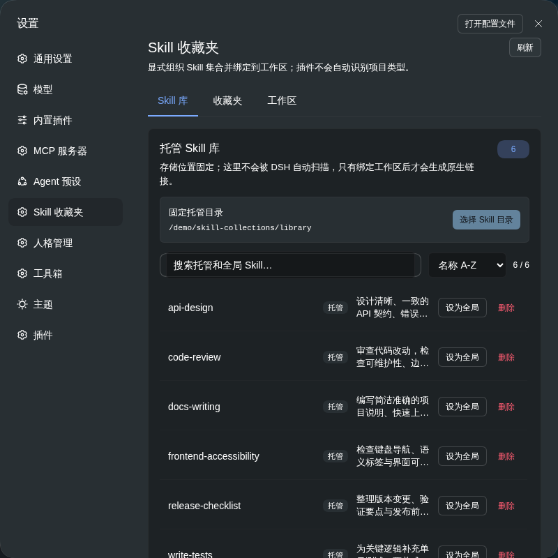
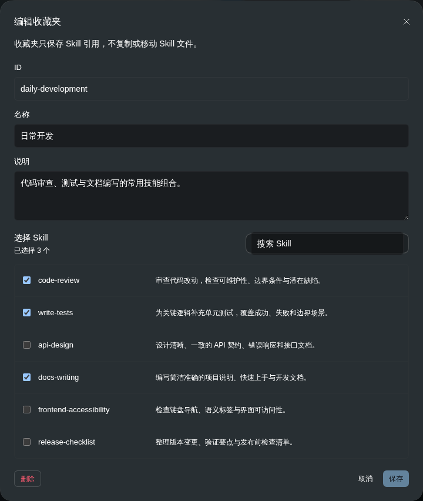

# DSH Skill Collections

**简体中文** | [English](README.en.md)

为 [DeepSeek Harness](https://github.com/deepseek-ai/deepseek-harness) 提供 **Skill 库、收藏夹和工作区管理**，在对话输入框中快速选择当前会话可用的 Skill。

把 Skill 集中收纳，按用途组织成可复用的收藏夹，再选择在哪些工作区启用。无需为每个项目重复复制同一份技能文件。

## 安装

```bash
dsh plugin --profile web add dsh-skill-collections
```

安装或更新后重启 DSH。npm 包包含 Host 和浏览器端构建产物，不需要克隆源码或在安装时编译。

兼容范围：Node.js `^22.19.0 || >=24.0.0`，DSH `>=0.2.1-rc.2 <0.3.0`。
依赖与高权限文件操作边界见 [安全说明](SECURITY.md)；商城修复及隔离 Profile
验证方法见 [DSH STORE 审核说明](docs/store-review.md)。本地验证通过不代表商城已批准。

**支持 Windows。** 使用预构建 npm 包无需 Bash 或 TypeScript；导入标准的 Skill 文件夹即可：

```text
code-review/
├── SKILL.md
└── references/       # 可选的参考资料
```

开发版包名为 `@dsh-external/dsh-skill-collections`，与 npm 版共享同一插件入口；已安装开发版时，请先移除旧安装，再安装 npm 版，避免重复加载。

## 功能

| 功能 | 说明 |
| --- | --- |
| Skill 库 | 从界面选择 Skill 文件夹导入，集中存储和管理 |
| 收藏夹 | 将技能组合成「日常开发」「前端质量」等集合，同一 Skill 可属于多个收藏夹 |
| 工作区绑定 | 为不同项目选择收藏夹或单独启用 Skill，支持工作区级排除 |
| 会话可用目录 | 读取 DSH 原生会话目录，与 `/` 菜单使用相同来源，不限于托管库 |
| 输入框快捷选择 | 搜索当前会话可用 Skill，将 `/skill-name` 插入消息草稿 |
| 全局 Skill | 将托管 Skill 设为全局，或将已有全局 Skill 收纳到托管库 |
| Agent 工具 | 通过 `skill_collection_list` 和 `skill_collection_manage` 查询和管理 |

## 界面预览

以下截图来自实际插件界面，使用示例 Skill 和收藏夹展示。

### 设置：Skill 库

在「设置 → Skill 收藏夹」中管理导入的技能，支持搜索、排序和全局设置。



### 设置：编辑收藏夹

为收藏夹选择成员。收藏夹只保存 Skill 引用，不复制技能内容。



### 使用：输入框快捷选择

从输入框旁的闪电图标打开列表，搜索并选择当前会话可用的 Skill。


## 快速上手

1. **导入 Skill**：打开「设置 → Skill 收藏夹 → Skill 库」，选择根目录包含 `SKILL.md` 的文件夹。
2. **组织收藏夹**：切换到「收藏夹」，新建一个集合并勾选所需技能。
3. **绑定工作区**：在「工作区」视图选择项目，启用收藏夹或单个 Skill。
4. **在对话中选择**：回到目标会话，点击输入框旁的 Skill 快捷选择图标，按名称或描述搜索。
5. **补充要求并发送**：选择技能后，其 `/skill-name` 会插入草稿；继续输入任务要求，再发送消息。

输入框旁另一个管理入口可直接打开当前工作区的 Skill 管理面板。

## 工作方式

插件将内容、组合和启用范围分开管理：

| 内容 | 存储位置 |
| --- | --- |
| 托管 Skill 内容 | `$DSH_HOME/skill-collections/library` |
| 收藏夹定义 | `$DSH_HOME/skill-collections/collections/*.yml` |
| 工作区选择 | `<workspace>/.dsh/skill-collections.yml` |
| 工作区原生挂载 | `<workspace>/.dsh/skills` |

未设置 `DSH_HOME` 时，默认使用 `~/.dsh`。导入 Skill 只是收纳内容；由你选择绑定工作区，插件不会根据项目类型自动启用技能。

### 可用目录与工作区绑定

- **当前会话可用 Skill** 来自 DSH 原生 `skills/list`，跟随会话的工作目录和预设作用域，也可以包含本地、全局、内置和其他来源的技能。
- **工作区绑定** 展示本插件管理的技能与链接状态，不把托管库当作完整的会话目录。
- 同名优先级和用户调用策略沿用 DSH 原生规则；选择技能只修改草稿，不会自动发送或执行。

### 全局 Skill

「设为全局」会为托管内容建立全局链接；「取消全局」移除该链接，库中的原件继续保留。工作区级排除不影响全局技能。

收藏夹和工作区绑定的移除不会删除 Skill 内容。插件只清理自己管理的链接，不覆盖已有的同名用户文件。

## 配置示例

通常可直接通过界面管理；对应的配置格式如下。

收藏夹：

```yaml
version: 1
id: daily-development
name: 日常开发
description: 代码审查、测试与文档编写
skills:
  - code-review
  - write-tests
  - docs-writing
```

工作区选择：

```yaml
version: 1
collections:
  - daily-development
skills:
  enabled: []
  disabled:
    - docs-writing
```

## 开发

```bash
git clone https://github.com/caicongmin/dsh-skill-collections.git
cd dsh-skill-collections
```

在插件目录构建。`DSH_CHECKOUT` 指向提供 SDK 和构建依赖的 DSH 源码 checkout：

```bash
DSH_CHECKOUT=/path/to/deepseek-harness npm run build
npm run build:client
npm test
npm run pack:npm
```

从 DSH checkout 安装本地开发包：

```bash
pnpm dsh plugin --profile web add "file:/path/to/dsh-skill-collections"
```

`pack:npm` 在 `release/` 中生成并校验预构建包，统一处理包名、loader patch 和浏览器模块 ID。SDK 与 React 使用 DSH 提供的共享依赖，`yaml` 作为普通运行依赖安装。

贡献者发布流程见 [PUBLISHING.md](PUBLISHING.md)，版本记录见 [CHANGELOG.md](CHANGELOG.md)。

## 许可证与致谢

[MIT License](LICENSE)。

界面和文件管理实现借鉴了 MIT 许可的 [lcthe/dsh-skills-hub](https://github.com/lcthe/dsh-skills-hub)；可逆作用域与路径处理参考了 [fuxin123z/dsh-skill-manage](https://github.com/fuxin123z/dsh-skill-manage)。本插件在此基础上实现隔离托管库、收藏夹引用、显式工作区绑定与原生会话目录集成。
